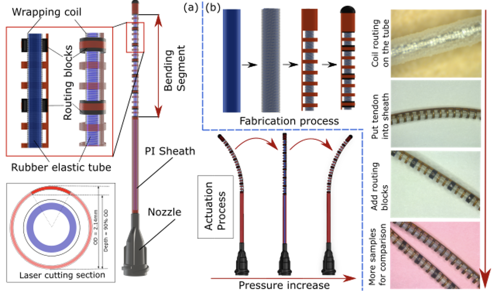
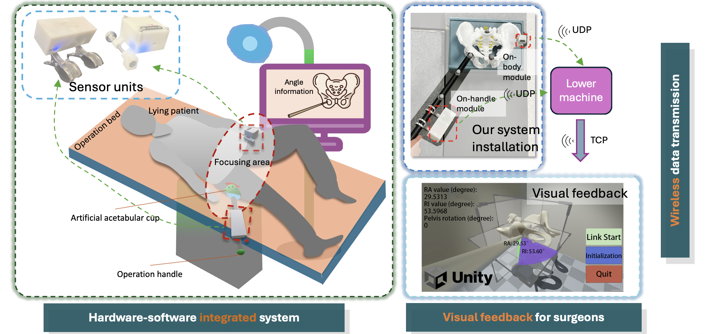
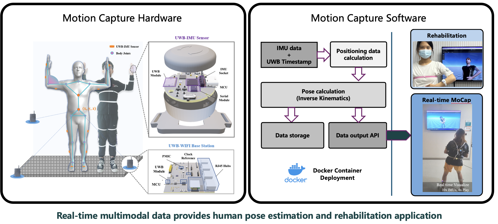

# Biography 🦁

Hi, I am **Chenyu Gu**, a Ph.D. student in Biomedical Engineering at **Washington University in St. Louis** 🇺🇸, where I am advised by **Dr. Ismael Seanez** in the Seanez Lab. My current work focuses on spatiotemporal control of transcutaneous spinal cord stimulation for people with chronic spinal cord injury.

Before that, I earned my M.S. in Bioengineering from the **Georgia Institute of Technology**, advised by [Dr. Jaydev Desai](https://research.gatech.edu/people/jaydev-desai) in the RoboMed Lab, where I worked on continuum and guidewire robots for minimally invasive surgery. I received my B.S. in Intelligent Medical Engineering from *Southern University of Science and Technology (SUSTech)* in Shenzhen, China 🇨🇳, under [Dr. Mingming Zhang](https://www.sustech.edu.cn/en/faculties/zhangmingming.html).

## Research Interests 🔬

* **Medical & Bio-Robotics:** Surgical robots, continuum and soft robotics, wearable and rehabilitation robotics, data-driven robotic control.
* **Neuromodulation & Neural Engineering:** Spinal cord stimulation, neurophysiological assessment, restoring motor function after injury.
* **Medical Devices & Digital Health:** Wearable and portable devices, surgical navigation, tele-rehabilitation.
* **Biomechanics & Physiological Signals:** Gait and locomotion analysis, motion tracking, multi-modal EMG/IMU sensing and analysis.

## News & Updates 🎉

* **[Nov 2026]** Our paper on the modified COAST guidewire robot was accepted to *npj Robotics*!
* **[Aug 2026]** Started my Ph.D. in Biomedical Engineering at Washington University in St. Louis, joining the Seanez Lab! 🎓
* **[May 2026]** My continuum robotics paper won the **Best Student Paper Award** at ISMR 2026! 🏆
* **[May 2026]** Graduated from Georgia Tech with an M.S. in Bioengineering!
* **[Feb 2026]** My paper on continuum robotics was accepted to ISMR 2026!
* **[Aug 2025]** Started as a Graduate Teaching Assistant for *Machine Learning (CS 7641)* at Georgia Tech.
* **[Jul 2025]** Joined the COAST guidewire robot project and led K–12 outreach as a Georgia Tech CEISMC summer program leader.
* **[Mar 2025]** Our paper on a portable inertial navigation system for total hip arthroplasty was published in *IEEE Transactions on Instrumentation and Measurement*.
* **[Aug 2024]** Started my Master's program at Georgia Tech.
* **[Jun 2024]** Graduated from Southern University of Science and Technology with a Bachelor's degree in Intelligent Medical Engineering.

## Selected Projects 🤖

  

    

      <h3><a href="/projects/scs">Spatiotemporal Control of Transcutaneous Spinal Cord Stimulation</a></h3>
      
Seanez Lab, Washington University in St. Louis · Current

      

        Multielectrode transcutaneous spinal cord stimulation can recruit motor pools below a spinal cord injury without surgery, but where and when to stimulate is still an open question. In an ongoing study with chronic spinal cord injury participants, we optimize array positioning to increase targeted joint torque and use frequency modulation to probe posterior root-muscle reflexes, combining high-density EMG, dynamometry, and 3D kinematics.
      

    

  

  

    

      
    

    

      <h3><a href="/projects/hydro">Design and Modeling of a Hydraulic Continuum Robot</a></h3>
      
RoboMed Lab, Georgia Tech · ISMR 2026 Best Student Paper

      

        We designed and modeled a hydraulically actuated, polymer-based continuum robot with a 2.14 mm outer diameter for minimally invasive surgery. A custom coiled hydraulic actuator and internal routing blocks suppress unwanted twisting, and a Preisach hysteresis model makes tip deflection predictable. The robot is demonstrated navigating a 2D aortic-arch phantom.
      

    

  

  

    

      
    

    

      <h3><a href="/projects/ins">Inertial Navigation System for Total Hip Arthroplasty</a></h3>
      
Brain-robot Rehabilitation Lab, SUSTech · IEEE T-IM 2025

      

        In direct anterior total hip arthroplasty, accurate radiographic anteversion and inclination angles are essential but are typically determined using X-ray, exposing patients to radiation. We developed a wireless inertial navigation system with real-time visualization that removes this need, reaching 1.24° and 1.89° RMSE respectively.
      

    

  

  

    

      
    

    

      <h3><a href="/projects/dip">Deep Learning Framework for Motion Reconstruction</a></h3>
      
Brain-robot Rehabilitation Lab, SUSTech

      

        We developed a deep learning framework that reconstructs 3D human motion from sparse IMU data and UWB localization signals. Recurrent networks capture motion dynamics over time, producing accurate full-body reconstruction for biomechanics, rehabilitation monitoring, and virtual reality.
      

    

  

<a href="/projects/">See all projects →</a>

